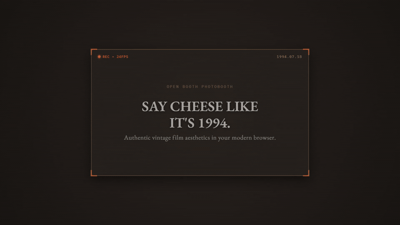

<div align="center">

<p align="center">
  <a href="https://openbooth.vercel.app">
    
  </a>
</p>

# OpenBooth

**The retro, tactile photo booth experience right in your browser.**

[](https://github.com/Malfrox/OpenBooth/actions/workflows/ci.yml)
[](https://react.dev/)
[](https://tanstack.com/router)
[](https://tailwindcss.com/)
[](https://vitejs.dev/)
[](LICENSE)
[](https://vercel.com/new/clone?repository-url=https%3A%2F%2Fgithub.com%2FMalfrox%2FOpenBooth)

[**Try Live Demo**](https://openbooth.vercel.app) · [**Report Bug**](https://github.com/Malfrox/OpenBooth/issues)

</div>

---

## Overview

**OpenBooth** brings back the analog joy of mechanical photo booths with a warm, tactile design. Capture instant portraits, test curated analog film tones, and export authentic 4-photo vertical strips and Polaroid frames directly from your browser—with zero server uploads.

Experience OpenBooth in action at **[openbooth.vercel.app](https://openbooth.vercel.app)**.

---

## Architecture & Data Flow

OpenBooth operates entirely client-side. Video processing, real-time filtering, and image composite generation run on your local hardware:

```
┌─────────────────┐       ┌────────────────────────┐       ┌─────────────────────────┐       ┌─────────────────┐
│ WebRTC Camera   │ ───>  │ Web Worker             │ ───>  │ HTML5 / Offscreen       │ ───>  │ Blob / DataURL  │
│ MediaStream     │       │ Filter Pipeline        │       │ Canvas Composite        │       │ Instant Export  │
└─────────────────┘       └────────────────────────┘       └─────────────────────────┘       └─────────────────┘
```

1. **WebRTC Ingestion**: Accesses local camera devices via `navigator.mediaDevices.getUserMedia` with configurable aspect ratio and frame rate.
2. **Web Worker Filters**: Image frames and color matrices are offloaded to background Web Workers (`filter.worker.ts`) to avoid main thread UI jank during processing.
3. **Canvas Composition**: Renders individual frames or multi-shot photobooth strips with border padding, customizable timestamps, and branding onto HTML5 or `OffscreenCanvas`.
4. **Blob / DataURL Output**: Converts processed canvas targets to PNG/JPEG binary blobs for immediate local download and preview without any network transit.

---

## Key Features

- **📸 Tactile Viewfinder & Camera HUD**
  - Live mirror preview with rule-of-thirds alignment grid and subtle vignette.
  - Cycleable countdown timer (`Off`, `3s`, `5s`, `10s`) with Web Audio API countdown beeps and mechanical shutter feedback.
  - Quick front/rear camera flip for mobile and dual-camera devices.
  - Authentic flash animation on capture.

- **🎞️ Vintage Photo Strip & Polaroid Layouts**
  - Generates classic vertical 4-shot photobooth strips complete with timestamps and custom branding.
  - Individual polaroid cards with instant preview and download controls.
  - Customizable borders, frames, and export formats (PNG/JPEG).

- **🎨 Curated Analog Film Filters**
  - **Vintage Film:** _Kodak Gold 200_, _Fujifilm Superia_, _Polaroid SX70_, _Cinestill 800T_.
  - **Monochrome & Classic:** _Classic B&W_, _High Contrast B&W_, _Normal_.
  - **Creative & Effects:** _Golden Hour_, _Pastel_, _Vibrant_, _Cyberpunk_.
  - Real-time CSS canvas shader filtering for latency-free live preview.

- **🔒 Privacy First & 100% Client-Side**
  - All video processing, filter rendering, and photo strip assembly happen locally on your device.
  - Photos and camera feeds never leave your browser—zero server storage, tracking, or telemetry.

- **⚡ Modern, Ultra-Fast Stack**
  - Powered by **React 19**, **TanStack Start / TanStack Router**, **Tailwind CSS v4**, and **Vite**.
  - Accessible toast notifications via **Sonner** and icons from **Lucide**.

---

## Quick Start (Run Locally)

### Prerequisites

- [Node.js](https://nodejs.org/) (v20.0.0 or higher recommended)
- `npm`, `pnpm`, or `bun`

### Installation

1. **Clone the repository:**

   ```bash
   git clone https://github.com/Malfrox/OpenBooth.git
   cd OpenBooth
   ```

2. **Install dependencies:**

   ```bash
   npm install
   ```

3. **Start the development server:**

   ```bash
   npm run dev
   ```

4. **Open in browser:**
   Navigate to [http://localhost:3000](http://localhost:3000) (or the port indicated in your terminal). Grant camera permissions when prompted.

---

## Local HTTPS & Camera Permissions (Mobile / Network Testing)

Browsers require a **Secure Context** (`https://` or `localhost`) to access camera hardware via `getUserMedia()`.

- **Local Machine Testing:** Accessing `http://localhost:3000` is treated as a secure context by default.
- **LAN / Mobile Device Testing:** If accessing your local dev server from an external device on the local network (e.g., `http://192.168.x.x:3000`), modern browsers will block camera access over unencrypted HTTP.
  - Run Vite with HTTPS enabled (e.g., using `@vitejs/plugin-basic-ssl` or local reverse proxy tools like `mkcert` / `caddy`).
  - Or configure browser security flags for testing (e.g., `chrome://flags/#unsafely-treat-insecure-origin-as-secure` with your LAN IP).
  - Ensure the browser has permission to access the camera in your OS settings and browser site permissions.

---

## Scripts

| Command              | Action                                                      |
| -------------------- | ----------------------------------------------------------- |
| `npm run dev`        | Starts Vite development server with hot-reload              |
| `npm run build`      | Builds client & server bundles for production               |
| `npm run build:dev`  | Builds bundles targeting development mode                   |
| `npm run preview`    | Previews the production build locally                       |
| `npm run lint`       | Runs ESLint checks across project files                     |
| `npm run typecheck`  | Runs TypeScript compiler (`tsc --noEmit`) type verification  |
| `npm run test`       | Executes unit tests with Vitest                             |
| `npm run format`     | Formats codebase with Prettier                              |

---

## Tech Stack

| Layer             | Technology                                                                         |
| ----------------- | ---------------------------------------------------------------------------------- |
| **Framework**     | [React 19](https://react.dev/) & [TanStack Start](https://tanstack.com/router)     |
| **Routing**       | [TanStack Router](https://tanstack.com/router)                                     |
| **Styling**       | [Tailwind CSS v4](https://tailwindcss.com/) & [tw-animate-css](https://github.com) |
| **Icons**         | [Lucide React](https://lucide.dev/)                                                |
| **Notifications** | [Sonner](https://sonner.emilkowal.ski/)                                            |
| **Tooling**       | [Vite 8](https://vitejs.dev/), TypeScript, Vitest, Nitro                           |
| **Deployment**    | [Vercel](https://vercel.com)                                                       |

---

## Design System

OpenBooth is built around a warm, vintage-inspired palette:

- **Cream (`#F9F7F3`)**: Off-white photo-paper backdrop
- **Terracotta (`#D97040`)**: Tactile shutter action button
- **Sage Green (`#6BA89E`)**: Retro secondary accents
- **Warm Charcoal (`#3D3830`)**: High-legibility headline tone
- **Film Gold (`#D4A574`)**: Golden hour and success state highlight

---

## Contributing & Quality Gates

Contributions, feature ideas, and pull requests are welcome!

Before submitting a pull request, ensure all local quality gates pass:

1. **Linting:** Ensure code adheres to project style rules.
   ```bash
   npm run lint
   ```
2. **Type Checking:** Verify complete TypeScript type safety without emissions.
   ```bash
   npm run typecheck
   ```
3. **Unit Tests:** Verify all component and generator test suites pass.
   ```bash
   npm run test
   ```

### Contribution Workflow

1. Fork the Project
2. Create your Feature Branch (`git checkout -b feature/AmazingFeature`)
3. Validate Quality Gates (`npm run lint && npm run typecheck && npm run test`)
4. Commit your Changes (`git commit -m 'feat: add some amazing feature'`)
5. Push to the Branch (`git push origin feature/AmazingFeature`)
6. Open a Pull Request against `main`

---

## License

Distributed under the MIT License. See [LICENSE](LICENSE) for details.

---

<div align="center">
  <sub>Built with ❤️ for photobooth lovers. Inspired by analog photobooths and classic film.</sub>
</div>
